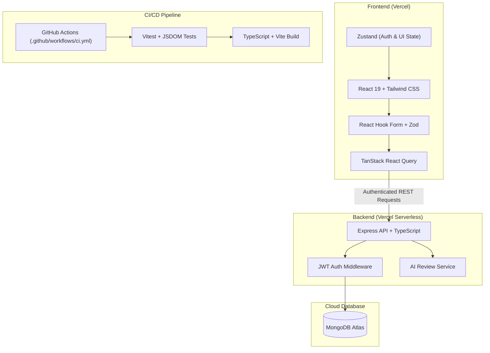

[](https://github.com/Drei-Nitsu/itelect4-project/actions/workflows/ci.yml)

# itelect4-project

Frontend application for **IT Elective 4 (Full Stack Web Development & Modern DevOps)**. Built with React 19, TypeScript, Vite, Tailwind CSS, TanStack Query, Zustand, React Hook Form, and Zod. Deployed on **Vercel**.

---

## 🌐 Live Deployment Links
- **Live Frontend App**: [https://itelect4-project-beta.vercel.app](https://itelect4-project-beta.vercel.app)
- **Live Backend API**: [https://itelect4-backend-beryl.vercel.app](https://itelect4-backend-beryl.vercel.app)

---

## 📖 About the Application
This application serves as a comprehensive student project submission and assessment portal featuring:
- **JWT-based Authentication**: Secure user registration and login state persisted across sessions using Zustand.
- **Course & Submission Management**: Students can view courses fetched dynamically from the API and submit GitHub repository links for evaluation.
- **Real-Time Status & Badging**: Dynamic badges reflecting submission statuses (`Submitted`, `Graded`, with scores and feedback).
- **AI-Powered Code Review (GT5)**: Automated intelligent feedback and grading evaluation interface powered by server-side AI integrations.
- **Comprehensive Automated Testing & CI (GT6)**: Unit, custom hook, and form validation tests implemented via Vitest & React Testing Library, enforced via GitHub Actions CI pipeline.

---

## 🏛️ Architecture Diagram



---

## 🛠️ Tech Stack
- **Framework & Bundler**: React 19, Vite
- **Language**: TypeScript (Strict Mode)
- **State Management**: Zustand (with local storage persistence)
- **Server State & Caching**: TanStack React Query
- **Styling**: Tailwind CSS
- **Form Validation**: React Hook Form with Zod Resolvers
- **Testing**: Vitest, React Testing Library, JSDOM, User Event
- **CI/CD & Hosting**: GitHub Actions, Vercel

---

## 🚀 How to Run Locally

### 1. Prerequisites
- Node.js `v22.12` or newer (Node `v24` LTS recommended)
- npm `v10+`

### 2. Clone the Repository
```bash
git clone https://github.com/Drei-Nitsu/itelect4-project.git
cd itelect4-project
```

### 3. Install Dependencies
```bash
npm install
```

### 4. Configure Environment Variables
Create a `.env` file in the project root:
```env
VITE_API_URL=https://itelect4-backend-beryl.vercel.app
```
*(Or use `http://localhost:4000` when running the backend locally)*.

### 5. Start the Development Server
```bash
npm run dev
```
Open your browser at `http://localhost:5173`.

### 6. Run Tests & Type Checking
```bash
# Run unit and integration tests (verbose mode)
npm test

# Run tests in watch mode
npm run test:watch

# Run TypeScript type check
npm run lint

# Create production build
npm run build
```

---

## 🧪 Testing Suite (GT6)
Automated testing is configured via Vitest with JSDOM:
1. **Component Test** (`src/components/SubmissionBadge.test.tsx`): Verifies rendering of repository links, numeric scores, and "Not graded yet" status badges.
2. **Hook Test** (`src/hooks/useToggle.test.ts`): Verifies custom hook initial state and alternating boolean states wrapped inside `act()`.
3. **Form Test** (`src/pages/LoginPage.test.tsx`): Verifies client-side validation triggers with Zod error messages and asserts no HTTP fetch calls are dispatched using `vi.spyOn(globalThis, "fetch")`.

---

## 🤖 AI-Use Disclosure
In compliance with the course syllabus and institutional AI usage policies:
- **AI Coding Assistants**: Google Antigravity (Gemini & Claude) was utilized as an engineering assistant for refactoring, drafting test suites, identifying dependency compatibility, and architecting CI configuration workflows.
- **Verification & Ownership**: All generated code, tests, and configurations were tested, type-checked, and validated locally by the repository owner.
